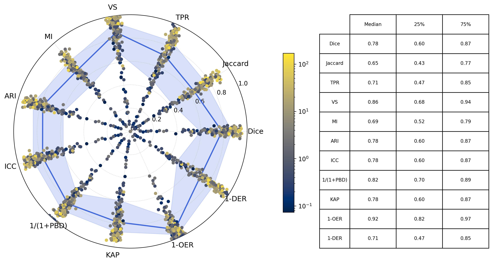
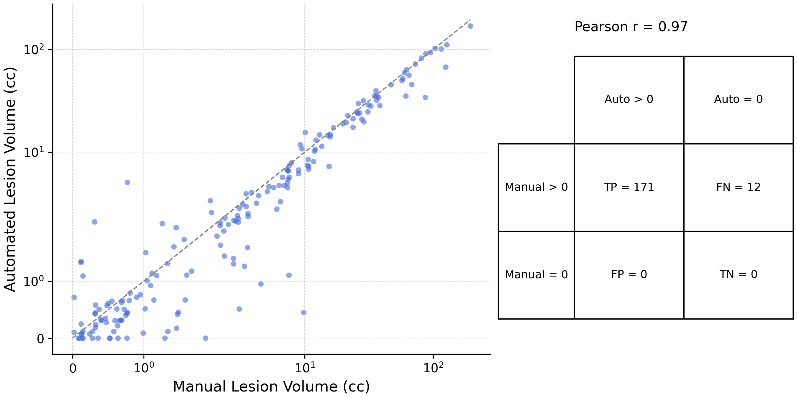
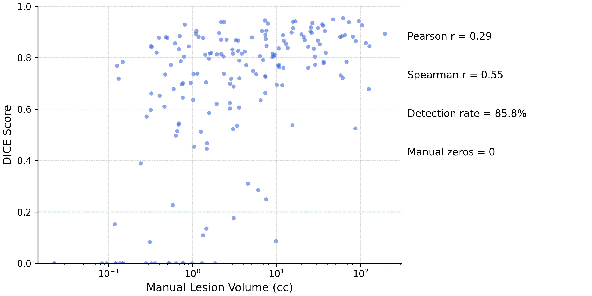

# EISRAD

**EISRAD** (Evaluation of Image Segmentations using RADar plots) is a Python toolkit designed to
quantitatively assess how well automated segmentation algorithms reproduce a manual (reference)
segmentation. It computes a variety of metrics and generates plots to help visualize algorithm
performance across a cohort.

---

## Scientific Overview

Below is an example **radar plot** summarizing multiple similarity metrics (e.g., Dice, Jaccard,
true positive rate) for each case in a cohort. Points are colored by the manual lesion volume on a
logarithmic scale. The solid blue line indicates the median performance across cases,
and the shaded blue band represents the interquartile range (IQR), highlighting variability.



Next, a **volume agreement scatter plot** shows how manual and automated lesion volumes correlate.
Each point represents one case; perfect agreement would lie on the diagonal line. The Pearson
correlation coefficient quantifies overall agreement, while the inset confusion matrix reports the
number of cases where both volumes are zero (no lesion) or nonzero.



Finally, the **DICE vs. lesion volume scatter plot** illustrates how algorithm accuracy (Dice)
depends on lesion size. The red dashed line marks the detection threshold (e.g., Dice = 0.2), and both
Pearson and Spearman correlations are reported.



---

## Input masks

EISRAD compares **binary** masks: a manual (reference) mask $A$ and an automated mask $B$, both
NIfTI images on the same voxel grid, where 1 marks lesion and 0 background. All metrics below are
defined for 0/1 masks. If a file contains other values (labels, probabilities), EISRAD binarizes it
at 0.5 (values $> 0.5$ become 1) and lists the affected files in a warning at the end of the run.
Use `-b` to binarize every mask at $> 0$ instead, or `-b T` to binarize every mask at $> T$
(e.g. `-b 0.3` for probability maps).

Both masks are reoriented to RAS before comparison. Pairs whose files are missing or whose shapes
differ are skipped (and counted in the terminal output).

---

## Metrics

### Per patient

Each patient contributes one value per metric, computed over all voxels of the image. With
$TP = |A \cap B|$, $FP = |B \setminus A|$, $FN = |A \setminus B|$ and $TN$ the remaining
background voxels:

| Metric | Formula | Notes |
|---|---|---|
| **Dice** | $\dfrac{2\,TP}{2\,TP + FP + FN}$ | Overlap; 1 if both masks are empty. For binary masks this is identical to the probabilistic distance (PBD) expressed as $1/(1+\mathrm{PBD})$, with $\mathrm{PBD} = \dfrac{\sum\lvert A-B\rvert}{2\sum A\,B} = \dfrac{FP+FN}{2\,TP} = \dfrac{1}{\mathrm{Dice}} - 1$. |
| **Jaccard** | $\dfrac{TP}{TP + FP + FN}$ | Intersection over union; $= \mathrm{Dice}/(2-\mathrm{Dice})$. 1 if both masks are empty. |
| **TPR** | $\dfrac{TP}{TP + FN}$ | Sensitivity: fraction of the manual lesion volume found. 1 if the manual mask is empty. |
| **VS** | $1 - \dfrac{\lvert FN - FP\rvert}{2\,TP + FP + FN}$ | Volumetric similarity: compares volumes only, not location. |
| **MI** | $\dfrac{2\,I(A;B)}{H(A) + H(B)}$ | Normalized mutual information of the voxel labels. |
| **ARI** | adjusted Rand index of the voxel labels | Agreement corrected for chance; can be negative. |
| **ICC** | $\dfrac{MS_b - MS_w}{MS_b + MS_w}$ | One-way intraclass correlation ICC(1,1) for two raters over all voxels, with $m = (A+B)/2$, $MS_w = \frac{1}{n}\sum\big[(A-m)^2 + (B-m)^2\big]$, $MS_b = \frac{2}{n-1}\sum (m - \bar m)^2$; can be negative. |
| **KAP** | $\dfrac{p_o - p_e}{1 - p_e}$ | Cohen's kappa: observed voxel agreement $p_o$ corrected for chance agreement $p_e$; 1 if both masks are empty; can be negative. |
| **1-OER** | $1 - \dfrac{\sum_{\text{detected}}\big(\lvert A_i\rvert + \lvert B_j\rvert\big) - 2\,TP}{MTA}$ | Outline error rate (Wack et al., 2012): voxel mismatch within lesions found in both masks. Lesions are 26-connected components; a lesion is detected if it overlaps the other mask; $MTA = (\lvert A\rvert + \lvert B\rvert)/2$. |
| **1-DER** | $1 - \dfrac{\sum_{\text{undetected}}\lvert A_i\rvert + \sum_{\text{undetected}}\lvert B_j\rvert}{MTA}$ | Detection error rate (Wack et al., 2012): volume of lesions present in only one mask (missed lesions and false-positive blobs). |

ARI, ICC, KAP, 1-OER and 1-DER can be negative (OER and DER can exceed 1). The plots clamp
negative values to 0 so all metrics share a 0–1 scale, and print a warning with the counts; the
metrics CSV keeps the raw values.

The **detection curve** (`--detection-curve`) treats each patient's manual mask as one lesion
(e.g. one stroke, however many components it has): its coverage is the patient's TPR, the
fraction of all manual lesion voxels that are also in $B$. A patient counts as detected at
threshold $t$ if this coverage is $\geq t$ and $> 0$; the curve shows the percentage of patients
with a manual lesion that are detected, with a 95% bootstrap confidence band. Patients without a
manual lesion are not included. The per-lesion version is described below.

### Per lesion

EISRAD always also evaluates each lesion separately, with the manual mask as reference:

- **Lesions** are the 26-connected components of the manual mask $A$.
- **Assigned automated voxels:** automated blobs (components of $B$) that overlap any manual
  lesion are shared out voxel by voxel to the nearest manual lesion (Euclidean distance in mm).
  Several blobs on one lesion are pooled; a blob spanning two lesions is split between them, so no
  automated voxel is counted twice.
- **False-positive lesions:** automated blobs that overlap no manual lesion.
- **Detected:** a manual lesion is detected if any of its voxels is in $B$.

For manual lesion $i$ with voxels $A_i$ and assigned automated voxels $B_i$:
$TP_i = |A_i \cap B|$, $FP_i = |B_i| - TP_i$, $FN_i = |A_i| - TP_i$, and

| Metric | Formula |
|---|---|
| **Dice** | $\dfrac{2\,TP_i}{2\,TP_i + FP_i + FN_i}$ |
| **Jaccard** | $\dfrac{TP_i}{TP_i + FP_i + FN_i}$ |
| **TPR** | $\dfrac{TP_i}{\lvert A_i\rvert}$ (the lesion's coverage) |
| **VS** | $1 - \dfrac{\lvert FN_i - FP_i\rvert}{2\,TP_i + FP_i + FN_i}$ |

The per-lesion **detection curve** (`*_lesion.png`) uses each lesion's coverage (TPR) instead of
the patient's: it shows the percentage of all manual lesions with coverage $\geq t$ and $> 0$,
with a 95% confidence band from resampling patients, so lesions of the same patient stay
together.

MI, ARI, ICC and KAP are not computed per lesion: they depend on how much background is included,
which has no natural definition for a single lesion. 1-OER would equal $2\,\mathrm{Dice} - 1$ per
lesion and is omitted. Lesions from the same patient are not independent, so per-lesion
correlations should be read with that in mind.

Every requested bar plot, heatmap and detection curve is written in both versions: per patient (e.g.
`bars.png`) and per lesion (`bars_lesion.png`); there is no per-lesion radar. With `-r`, a
`*_lesions.csv` with one row per manual or false-positive lesion is written next to the metrics
CSV.

---

## Installation

You can either install EISRAD into your Python environment or run it directly without installation.

### 1. Editable install

```bash
git clone https://github.com/mdschirmer/EISRAD.git
cd EISRAD
python3 -m venv venv
source venv/bin/activate
pip install -e .            # or: pip install -e ".[test]" to also run the tests
```

This installs the dependencies (listed in `pyproject.toml`) and makes the
`eisrad` command available in your shell. Check the installed version with
`eisrad --version`.

### 2. Run without installing

Install the dependencies listed in `pyproject.toml` (e.g. `pip install matplotlib nibabel numpy pandas scikit-learn scipy`),
then, from the project root (where the `eisrad/` folder lives), run:

```bash
# Using module invocation
PYTHONPATH=. python -m eisrad [OPTIONS]

# Or directly with the entrypoint script
python eisrad/__main__.py [OPTIONS]
```

No need for `pip install` if you prefer in-place execution.

---

## Usage

At minimum, provide an input CSV and output paths:

```bash
eisrad -f pair_list.csv -o radar.png -r metrics.csv
```

- **`-f, --file`**: CSV file with `manual,auto` columns pointing to NIfTI mask paths.  
- **`-o, --output`**: Output radar plot image (default `polar_results.png`).  
- **`-r, --results`**: Output CSV for numeric metrics (plus `*_lesions.csv` with per-lesion metrics).

Run `eisrad -h` for the full list of flags.

### Key options

- `-b, --binarize [T]`: Binarize all masks at `> T → 1`; `-b` alone uses `T = 0` (default: only non-binary masks are binarized, at 0.5).  
- `-l, --log`: Log color scale for the radar and bar plots (points are colored by manual lesion volume).  
- `-L, --label` / `-u, --unit`: Colorbar label and unit (default `Manual lesion volume`, `cc`).  
- `-j, --jobs N`: Process `N` file pairs in parallel (default: available CPUs − 1; `-j 1` processes one pair at a time). With masks on a slow network or backup drive, a moderate `N` (e.g. 4–8) can be faster than the default.  
- `--dice-threshold FLOAT`: Low-Dice cutoff (default `0.2`).  
- `--low-dice-csv PATH`: Save cases with Dice < threshold.  
- `--vol-diff-threshold FLOAT`: Relative volume-diff cutoff.  
- `--high-vol-diff-csv PATH`: Save cases exceeding vol-diff.  
- `--volume-heatmap PATH`: Save manual vs auto volume heatmap with marginal volume histograms (`--scatter-volume` still works as an alias).  
- `--dice-heatmap PATH`: Save Dice vs volume heatmap with marginal Dice histogram (`--scatter-dice` still works as an alias).
- `--bar-plot PATH`: Save metric bar plot (median + IQR, cases as points), an alternative to the radar.
- `--detection-curve PATH`: Save the detection rate vs. coverage threshold curve (per patient, plus `*_lesion` per lesion).

---

## Examples

### Basic radar & metrics

```bash
eisrad -f segs.csv -o radar.png -r metrics.csv
```

### Full evaluation with all outputs

```bash
eisrad \
  -f comparison.csv \
  -o comparison/radar.png \
  -r comparison/metrics.csv \
  -l \
  --dice-threshold 0.2 \
  --low-dice-csv comparison/low_dice.csv \
  --vol-diff-threshold 0.5 \
  --high-vol-diff-csv comparison/high_vol_diff.csv \
  --volume-heatmap comparison/vol_heatmap.png \
  --dice-heatmap comparison/dice_heatmap.png \
  --bar-plot comparison/bars.png \
  --detection-curve comparison/detection.png
```

This generates:

- **Radar plot (log scale)**: `comparison/radar.png`  
- **Metrics CSV**: `comparison/metrics.csv`  
- **Low-Dice cases**: `comparison/low_dice.csv`  
- **High vol-diff cases**: `comparison/high_vol_diff.csv`  
- **Volume heatmap**: `comparison/vol_heatmap.png`  
- **DICE heatmap**: `comparison/dice_heatmap.png`  
- **Metric bar plot**: `comparison/bars.png`  
- **Detection curve**: `comparison/detection.png`  

---

## Project Structure

```
eisrad/
├─ __main__.py
├─ io.py
├─ metrics.py
├─ reports.py
└─ plots.py
README.md
pyproject.toml
```

---

## License

Released under the MIT License.
