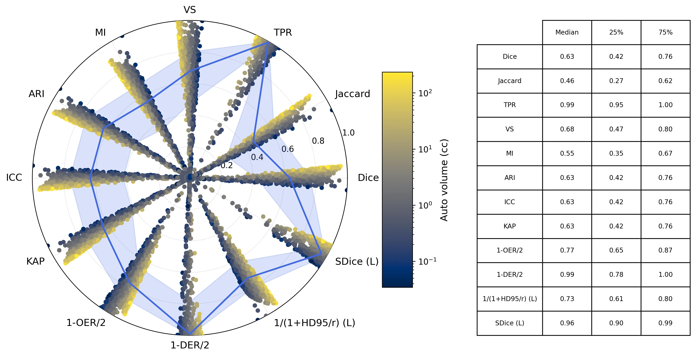
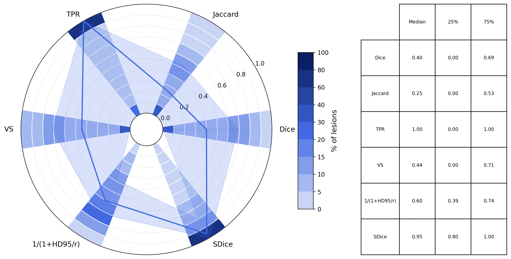
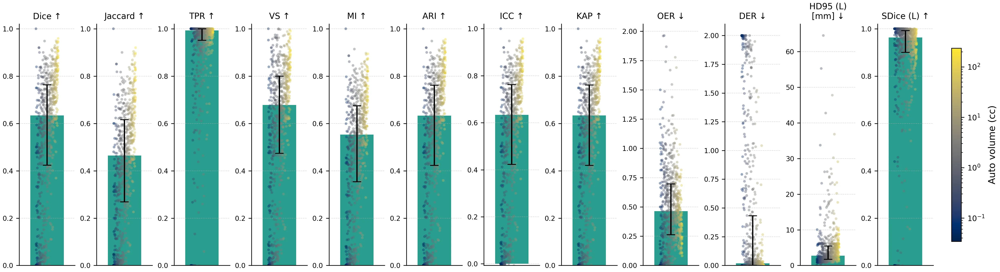
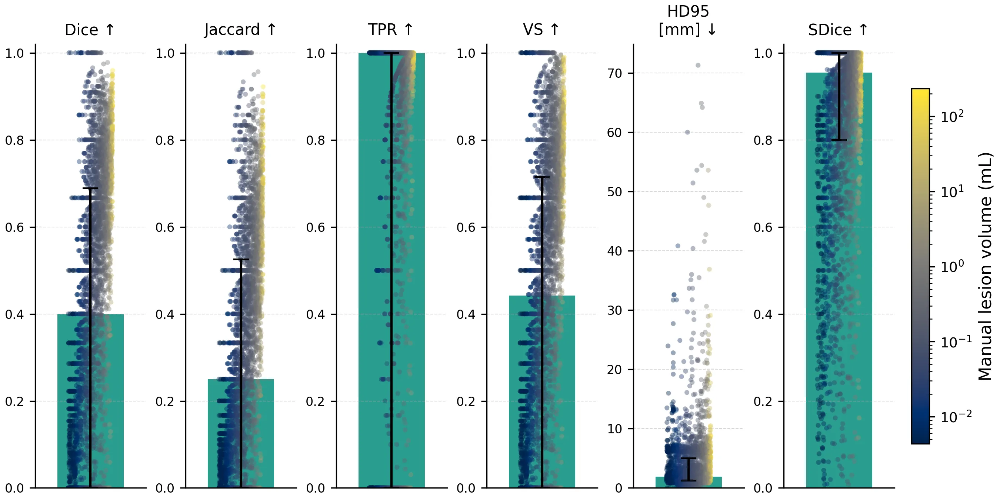
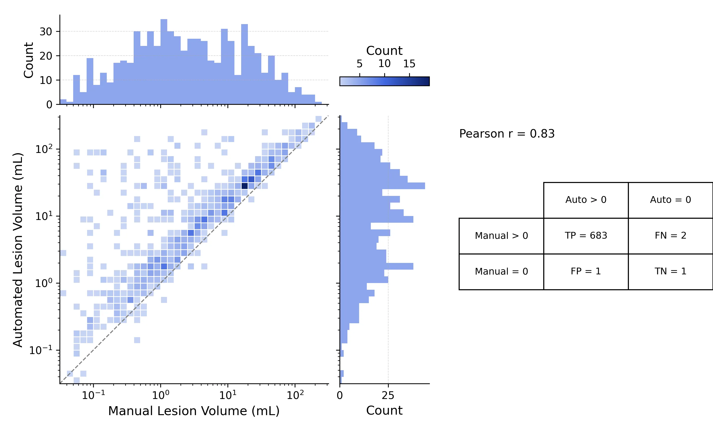
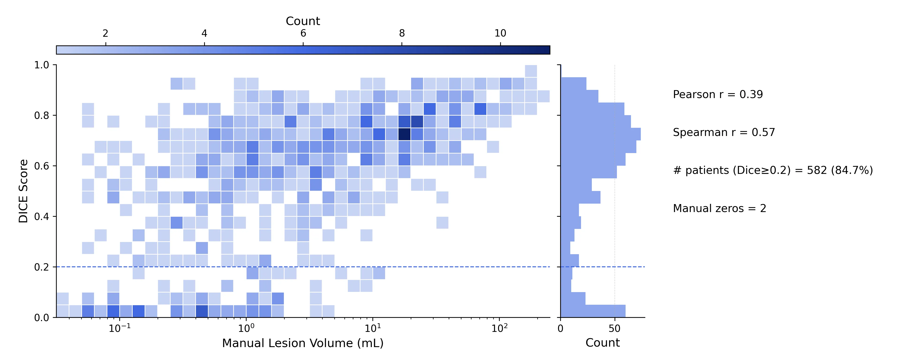
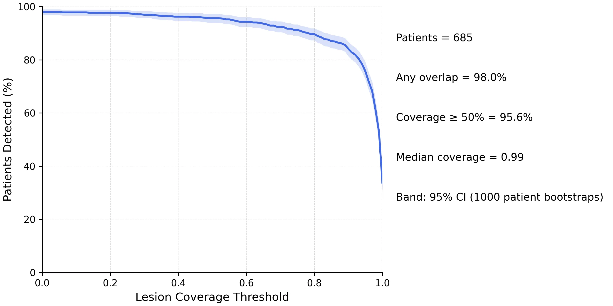
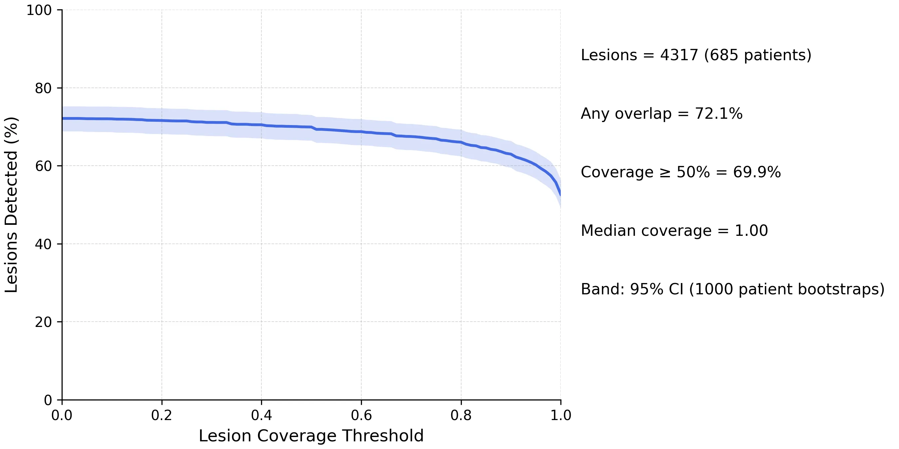

# EISRAD

**EISRAD** (Evaluation of Image Segmentations using RADar plots) is a Python toolkit designed to
quantitatively assess how well automated segmentation algorithms reproduce a manual (reference)
segmentation. It computes a variety of metrics and generates plots to help visualize algorithm
performance across a cohort.

---

## Example output

All plots below come from one EISRAD run on a stroke cohort (DWI lesion masks, manual vs.
automated). Every plot is written per patient and per lesion (`*_lesion`); the most informative
versions are shown here.

### Radar plots



**Radar plot (per patient).** One spoke per metric, all scaled so 1 is best. Each dot is a
patient, coloured by manual lesion volume and placed left or right of the spoke by volume (small
clockwise, large counter-clockwise), so a patient sits at the same position on every spoke. The
blue line is the median, the band the interquartile range; the table lists both.



**Radar plot (per lesion).** The same layout for individual lesions. Instead of thousands of
dots, each spoke shows how the lesions are distributed: every segment is a 0.1-wide value range,
coloured by the share of lesions in it (white = none).

### Bar plots



**Bar plot (per patient).** An alternative to the radar with one panel per metric, using raw
values in their own units (e.g. HD95 in mm, OER/DER from 0 to 2). Arrows show whether higher (↑)
or lower (↓) is better. Bars are medians, error bars the IQR, dots the patients, ordered by
volume as on the radar.



**Bar plot (per lesion).** The same for individual lesions.

### Volume and Dice



**Volume heatmap.** Manual vs. automated lesion volume on log axes; cell colour is the number of
patients, and perfect agreement lies on the diagonal. The histograms show both volume
distributions, and the table counts patients with and without lesions in each mask. The lesion
version compares each manual lesion with its automated counterpart and counts detected, missed
and false-positive lesions.



**Dice heatmap.** Dice against manual lesion volume, showing how overlap depends on lesion size.
The dashed line marks the Dice threshold (default 0.2); the histogram shows the Dice
distribution.

### Detection



**Detection curve (per patient).** The share of patients whose lesion is found, as a function of
how much of it must be covered (coverage threshold). At 0 it is the share with any overlap at
all. The band is a 95% confidence interval.



**Detection curve (per lesion).** The same for individual lesions: small lesions that are missed
pull this curve below the patient curve.

---

## Input masks

EISRAD compares **binary** masks: a manual (reference) mask $A$ and an automated mask $B$, both
NIfTI images on the same voxel grid, where 1 marks lesion and 0 background. All metrics below are
defined for 0/1 masks. If a file contains other values (labels, probabilities), EISRAD binarizes it
at 0.5 (values $> 0.5$ become 1) and lists the affected files in a warning at the end of the run.
Use `-b` to binarize every mask at $> 0$ instead, or `-b T` to binarize every mask at $> T$
(e.g. `-b 0.3` for probability maps).

Both masks are reoriented to RAS before comparison. Pairs whose files are missing or whose shapes
differ are skipped (and counted in the terminal output).

---

## Metrics

Volumes are reported in mL (1 mL = 1 cm³ = 1000 mm³).

### Per patient

Each patient contributes one value per metric, computed over all voxels of the image. With
$TP = |A \cap B|$, $FP = |B \setminus A|$, $FN = |A \setminus B|$ and $TN$ the remaining
background voxels:

| Metric | Formula | Notes |
|---|---|---|
| **Dice** | $\dfrac{2\,TP}{2\,TP + FP + FN}$ | Overlap; 1 if both masks are empty. For binary masks this is identical to the probabilistic distance (PBD) expressed as $1/(1+\mathrm{PBD})$, with $\mathrm{PBD} = \dfrac{\sum\lvert A-B\rvert}{2\sum A\,B} = \dfrac{FP+FN}{2\,TP} = \dfrac{1}{\mathrm{Dice}} - 1$. |
| **Jaccard** | $\dfrac{TP}{TP + FP + FN}$ | Intersection over union; $= \mathrm{Dice}/(2-\mathrm{Dice})$. 1 if both masks are empty. |
| **TPR** | $\dfrac{TP}{TP + FN}$ | Sensitivity: fraction of the manual lesion volume found. 1 if the manual mask is empty. |
| **VS** | $1 - \dfrac{\lvert FN - FP\rvert}{2\,TP + FP + FN}$ | Volumetric similarity: compares volumes only, not location. |
| **MI** | $\dfrac{2\,I(A;B)}{H(A) + H(B)}$ | Normalized mutual information of the voxel labels. |
| **ARI** | adjusted Rand index of the voxel labels | Agreement corrected for chance; can be negative. |
| **ICC** | $\dfrac{MS_b - MS_w}{MS_b + MS_w}$ | One-way intraclass correlation ICC(1,1) for two raters over all voxels, with $m = (A+B)/2$, $MS_w = \frac{1}{n}\sum\big[(A-m)^2 + (B-m)^2\big]$, $MS_b = \frac{2}{n-1}\sum (m - \bar m)^2$; can be negative. |
| **KAP** | $\dfrac{p_o - p_e}{1 - p_e}$ | Cohen's kappa: observed voxel agreement $p_o$ corrected for chance agreement $p_e$; 1 if both masks are empty; can be negative. |
| **1-OER/2** | $1 - \dfrac{\mathrm{OER}}{2}$, $\ \mathrm{OER} = \dfrac{\sum_{\text{detected}}\big(\lvert A_i\rvert + \lvert B_j\rvert\big) - 2\,TP}{MTA}$ | Outline error rate (Wack et al., 2012): voxel mismatch within lesions found in both masks. Lesions are 26-connected components; a lesion is detected if it overlaps the other mask; $MTA = (\lvert A\rvert + \lvert B\rvert)/2$. OER lies in $[0, 2]$, so it is halved to fit the 0–1 scale. |
| **1-DER/2** | $1 - \dfrac{\mathrm{DER}}{2}$, $\ \mathrm{DER} = \dfrac{\sum_{\text{undetected}}\lvert A_i\rvert + \sum_{\text{undetected}}\lvert B_j\rvert}{MTA}$ | Detection error rate (Wack et al., 2012): volume of lesions present in only one mask (missed lesions and false-positive blobs). DER lies in $[0, 2]$ (2 = nothing overlaps). |
| **1/(1+HD95/r) (L)** | $\dfrac{\sum_i V_i\,\big(1 + \mathrm{HD95}_i/r_i\big)^{-1}}{\sum_i V_i}$ | Lesion-averaged boundary distance score. $\mathrm{HD95}_i$ is the per-lesion HD95 in mm (see [Per lesion](#per-lesion)), $r_i$ the radius of a sphere with lesion $i$'s volume $V_i$, so each lesion's score is relative to its own size (0.5 = off by about one lesion radius). Averaged over the detected manual lesions, weighted by volume. Missed lesions are left out (they count in 1-DER/2 and the detection curves); 0 if no lesion was detected, 1 if neither mask has a lesion. The CSV also lists the volume-weighted mean HD95 in mm as `HD95_mm (L)`. |
| **SDice (L)** | $\dfrac{\sum_i V_i\,\mathrm{SDice}_i}{\sum_i V_i}$ | Lesion-averaged surface Dice: the per-lesion surface Dice (see [Per lesion](#per-lesion)), averaged over the detected manual lesions, weighted by volume; missed lesions are left out. 0 if no lesion was detected, 1 if neither mask has a lesion. |

The two halved error rates split the Dice error into an outline part and a detection part:
$\mathrm{OER}/2 + \mathrm{DER}/2 = 1 - \mathrm{Dice}$.

**(L)** marks measures that are computed per manual lesion and then averaged per patient. They
are not the same as the corresponding whole-mask measures reported by other tools.

ARI, ICC and KAP can be negative (agreement worse than chance). The radar plot clamps negative
values to 0 so all metrics share a 0–1 scale, and prints a warning with the counts; the metrics
CSV and the bar plots keep the raw values.

The **bar plot** (`--bar-plot`) shows each metric in its own panel with its own y axis, using the
raw values rather than the radar's 0–1 scores: OER and DER (0–2) instead of 1-OER/2 and 1-DER/2, HD95 in mm
instead of $1/(1+\mathrm{HD95}/r)$, and unclamped ARI, ICC and KAP. Arrows in the panel titles
show whether higher (↑) or lower (↓) is better. Bars are medians, error bars the IQR, and dots the
individual patients (or lesions); each dot keeps the same horizontal position in every panel.

The **detection curve** (`--detection-curve`) treats each patient's manual mask as one lesion
(e.g. one stroke, however many components it has): its coverage is the patient's TPR, the
fraction of all manual lesion voxels that are also in $B$. A patient counts as detected at
threshold $t$ if this coverage is $\geq t$ and $> 0$; the curve shows the percentage of patients
with a manual lesion that are detected, with a 95% bootstrap confidence band. Patients without a
manual lesion are not included. The per-lesion version is described below.

### Per lesion

EISRAD always also evaluates each lesion separately, with the manual mask as reference:

- **Lesions** are the 26-connected components of the manual mask $A$.
- **Assigned automated voxels:** automated blobs (components of $B$) that overlap any manual
  lesion are shared out voxel by voxel to the nearest manual lesion (Euclidean distance in mm).
  Several blobs on one lesion are pooled; a blob spanning two lesions is split between them, so no
  automated voxel is counted twice.
- **False-positive lesions:** automated blobs that overlap no manual lesion.
- **Detected:** a manual lesion is detected if any of its voxels is in $B$.

For manual lesion $i$ with voxels $A_i$ and assigned automated voxels $B_i$:
$TP_i = |A_i \cap B|$, $FP_i = |B_i| - TP_i$, $FN_i = |A_i| - TP_i$, and

| Metric | Formula |
|---|---|
| **Dice** | $\dfrac{2\,TP_i}{2\,TP_i + FP_i + FN_i}$ |
| **Jaccard** | $\dfrac{TP_i}{TP_i + FP_i + FN_i}$ |
| **TPR** | $\dfrac{TP_i}{\lvert A_i\rvert}$ (the lesion's coverage) |
| **VS** | $1 - \dfrac{\lvert FN_i - FP_i\rvert}{2\,TP_i + FP_i + FN_i}$ |
| **HD95** | 95th percentile of the surface-to-surface distances between $A_i$ and $B_i$ (both directions, in mm) |
| **SDice** | share of the surface voxels of $A_i$ and $B_i$ within tolerance $\tau$ of the other surface (by default one voxel in every direction; `--surface-tolerance MM` for a fixed tolerance) |

HD95 and SDice are only computed for detected lesions; for missed lesions they are left empty in
the lesions CSV.

The per-lesion **detection curve** (`*_lesion.png`) uses each lesion's coverage (TPR) instead of
the patient's: it shows the percentage of all manual lesions with coverage $\geq t$ and $> 0$,
with a 95% confidence band from resampling patients, so lesions of the same patient stay
together.

MI, ARI, ICC and KAP are not computed per lesion: they depend on how much background is included,
which has no natural definition for a single lesion. 1-OER/2 would equal Dice per
lesion and is omitted. Lesions from the same patient are not independent, so per-lesion
correlations should be read with that in mind.

The radar and every requested bar plot, heatmap and detection curve are written in both versions:
per patient (e.g. `bars.png`) and per lesion (`bars_lesion.png`). Instead of one dot per lesion
(thousands of dots would hide everything), the per-lesion radar shows a heatmap along each spoke:
ring segments coloured by the share of lesions in each 0.1-wide value bin (one per ring) (classes 0–5, 5–10,
10–15, 15–20, 20–30, 30–40, 40–60, 60–80 and 80–100%: fine steps where most segments are, wider
towards 100; light to dark blue, with lightness alone separating the classes so it also works
for colour-blind readers; bins without any lesion are white), with the median line and IQR band on top. A small
hole in the middle keeps the spokes' 0-bins apart. HD95 and SDice are left
out for missed lesions, as in the lesions CSV, so their percentages refer to detected lesions. With `-r`, a
`*_lesions.csv` with one row per manual or false-positive lesion is written next to the metrics
CSV.

---

## Installation

You can either install EISRAD into your Python environment or run it directly without installation.

### 1. Editable install

```bash
git clone https://github.com/mdschirmer/EISRAD.git
cd EISRAD
python3 -m venv venv
source venv/bin/activate
pip install -e .            # or: pip install -e ".[test]" to also run the tests
```

This installs the dependencies (listed in `pyproject.toml`) and makes the
`eisrad` command available in your shell. Check the installed version with
`eisrad --version`.

### 2. Run without installing

Install the dependencies listed in `pyproject.toml` (e.g. `pip install matplotlib nibabel numpy pandas scikit-learn scipy`),
then, from the project root (where the `eisrad/` folder lives), run:

```bash
# Using module invocation
PYTHONPATH=. python -m eisrad [OPTIONS]

# Or directly with the entrypoint script
python eisrad/__main__.py [OPTIONS]
```

No need for `pip install` if you prefer in-place execution.

---

## Usage

At minimum, provide an input CSV and output paths:

```bash
eisrad -f pair_list.csv -o radar.png -r metrics.csv
```

- **`-f, --file`**: CSV file with `manual,auto` columns pointing to NIfTI mask paths.  
- **`-o, --output`**: Output radar plot image (default `polar_results.png`).

All plot files take their format from the file extension: `.png`, `.webp`, `.jpg`, `.pdf` or `.svg`.
`--format FMT` sets one format for all plots at once by replacing each plot file's extension
(e.g. `-o radar.png --format webp` writes `radar.webp`).
For smaller files use `.webp`, typically 3–5× smaller than PNG without visible loss at the
300 dpi EISRAD uses. `.jpg` saves less and blurs sharp text and lines more. `.pdf` and `.svg` are
vector formats for publications.  
- **`-r, --results`**: Output CSV for numeric metrics (plus `*_lesions.csv` with per-lesion metrics).

Run `eisrad -h` for the full list of flags.

### Key options

- `-b, --binarize [T]`: Binarize all masks at `> T → 1`; `-b` alone uses `T = 0` (default: only non-binary masks are binarized, at 0.5).  
- `-l, --log`: Log color scale for the radar and bar plots (points are colored by manual lesion volume).  
- `-L, --label` / `-u, --unit`: Colorbar label and unit (default `Manual lesion volume`, `mL`).  
- `--surface-tolerance MM`: Surface Dice tolerance in mm (default: one voxel in every direction).  
- `--format FMT`: Image format for all plots (`png`, `webp`, `jpg`, `pdf`, `svg`); replaces each plot file's extension.  
- `-j, --jobs N`: Process `N` file pairs in parallel (default `1`). Speeds up large cohorts; `eisrad -h` shows how many CPUs are available. With masks on a slow network or backup drive, a moderate `N` (e.g. 4–8) usually works best.  
- `--dice-threshold FLOAT`: Low-Dice cutoff (default `0.2`).  
- `--low-dice-csv PATH`: Save cases with Dice < threshold.  
- `--vol-diff-threshold FLOAT`: Relative volume-diff cutoff.  
- `--high-vol-diff-csv PATH`: Save cases exceeding vol-diff.  
- `--volume-heatmap PATH`: Save manual vs auto volume heatmap with marginal volume histograms (`--scatter-volume` still works as an alias).  
- `--dice-heatmap PATH`: Save Dice vs volume heatmap with marginal Dice histogram (`--scatter-dice` still works as an alias).
- `--bar-plot PATH`: Save metric bar plot (raw values, one panel per metric; median + IQR, cases as points), an alternative to the radar.
- `--detection-curve PATH`: Save the detection rate vs. coverage threshold curve (per patient, plus `*_lesion` per lesion).

---

## Examples

### Basic radar & metrics

```bash
eisrad -f segs.csv -o radar.png -r metrics.csv
```

### Full evaluation with all outputs

```bash
eisrad \
  -f comparison.csv \
  -o comparison/radar.png \
  -r comparison/metrics.csv \
  -l \
  --dice-threshold 0.2 \
  --low-dice-csv comparison/low_dice.csv \
  --vol-diff-threshold 0.5 \
  --high-vol-diff-csv comparison/high_vol_diff.csv \
  --volume-heatmap comparison/vol_heatmap.png \
  --dice-heatmap comparison/dice_heatmap.png \
  --bar-plot comparison/bars.png \
  --detection-curve comparison/detection.png
```

This generates:

- **Radar plot (log scale)**: `comparison/radar.png`  
- **Metrics CSV**: `comparison/metrics.csv`  
- **Low-Dice cases**: `comparison/low_dice.csv`  
- **High vol-diff cases**: `comparison/high_vol_diff.csv`  
- **Volume heatmap**: `comparison/vol_heatmap.png`  
- **DICE heatmap**: `comparison/dice_heatmap.png`  
- **Metric bar plot**: `comparison/bars.png`  
- **Detection curve**: `comparison/detection.png`  

---

## Project Structure

```
eisrad/
├─ __main__.py
├─ io.py
├─ metrics.py
├─ reports.py
├─ plots.py
└─ test_metrics.py
docs/              example figures used in this README
README.md
pyproject.toml
```

---

## License

Released under the MIT License.
